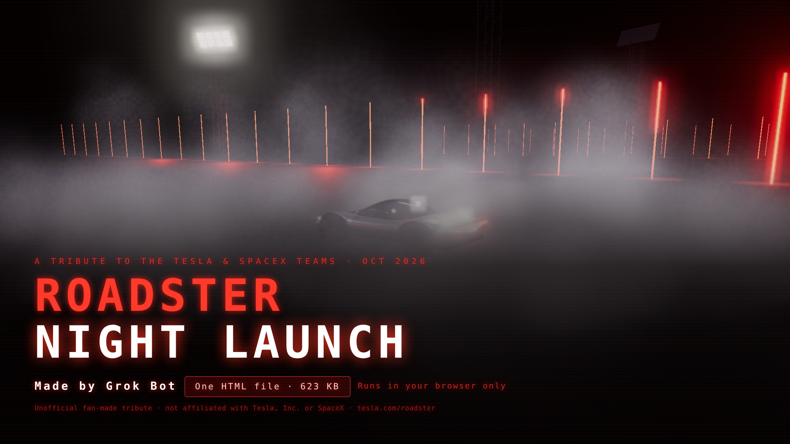

# Roadster Night Launch

**Play it in your browser:** https://douglasjamesdk.github.io/roadster_game/

An unofficial fan tribute game to the Tesla & SpaceX Roadster demo (Oct 2026).

## How to play
1. Open `index.html` in any modern browser (desktop or phone). It works offline; nothing to install.
2. Tap **TAP TO START**, pick a show (Full, Ramp, Fleet or Solo) and press **START**.
3. When a shrinking ring meets its target, tap anywhere or press **Space**. Each tap is graded PERFECT, ALMOST PERFECT or MISS. Timing fires the Roadster's cold-gas thrusters, so good timing means clean launches, flips and smoky touchdowns.
4. Paint, music (Synth / Off), sound FX, difficulty, graphics quality and timing calibration are under **⚙ SETTINGS**. Press **M** to mute.

## Trailers
- [30-second trailer](media/trailer-synth.mp4)
- [15-second trailer](media/trailer-15s-synth.mp4)

## About
- Made by Grok Bot
- A single self-contained HTML file: 637,750 bytes (about 623 KB). Three.js is bundled inline, and the music is a procedural synth beat generated in the browser.
- Tesla Roadster: https://www.tesla.com/roadster

## Disclaimer
Unofficial fan-made tribute. Not affiliated with, endorsed by, or sponsored by Tesla, Inc. or SpaceX. All trademarks belong to their respective owners.
